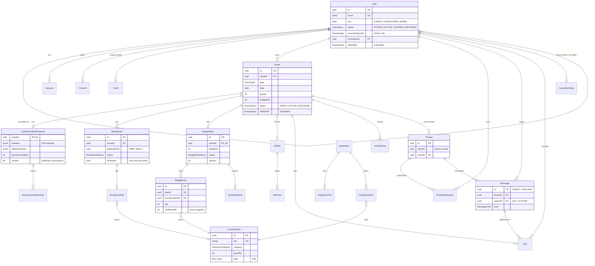

# Elation X — Entity relationship diagram

Source of truth: [`server/prisma/schema.prisma`](../../server/prisma/schema.prisma). Columns are abbreviated to keys and the fields that matter for relationships; see the schema for everything else. GitHub renders this diagram.

Tables not drawn (no relations worth showing): `PasswordResetToken`, `Inquiry`, `AuditLog`.
